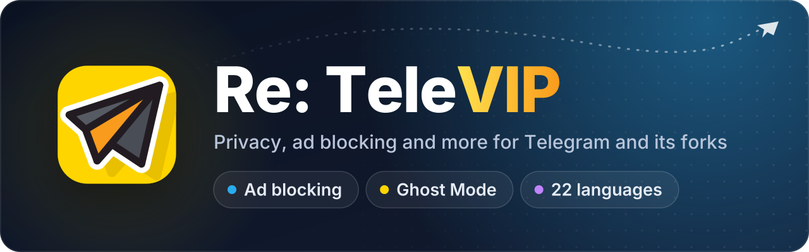
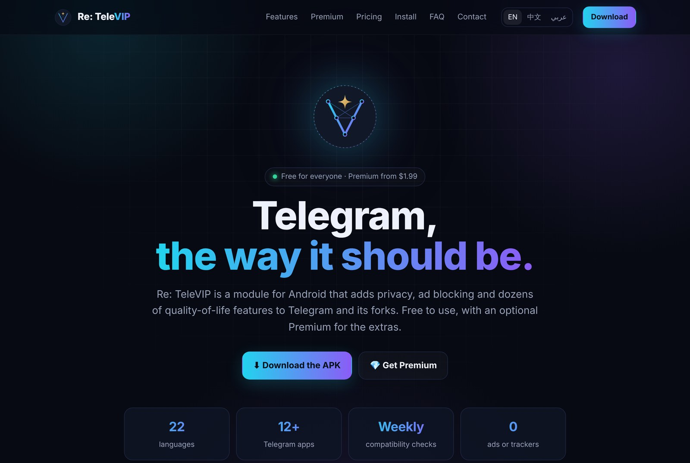

  <b>العربية</b> · <a href="README.md">English</a> · <a href="README.zh-CN.md">简体中文</a>

**مزايا للخصوصية وحظر الإعلانات وتسهيل الاستخدام في Telegram والنسخ المعدّلة منه، كوحدة Vector / Xposed.**

 

✨&nbsp;<a href="#-المزايا">المزايا</a> · 💎&nbsp;<a href="#-الاشتراك-المميز">الاشتراك المميز</a> · 🚀&nbsp;<a href="#-البدء">التثبيت</a> · 📱&nbsp;<a href="#-التطبيقات-المدعومة">التطبيقات المدعومة</a> · 🔒&nbsp;<a href="#-ما-الذي-يرسله">ما الذي يرسله</a> · 📝&nbsp;<a href="CHANGELOG.md">سجل التغييرات</a> · 🐞&nbsp;<a href="../../issues">الإبلاغ عن مشكلة</a>

 

المزايا والاشتراك المميز ودليل التثبيت بالعربية والإنجليزية والصينية على <b><a href="https://re-televip.cc">re-televip.cc</a></b>.

 

## ✨ المزايا

<table>
<tr>
  <th width="300">🛡️ الخصوصية</th>
  <th width="300">🎞️ الوسائط والقصص</th>
  <th width="300">💬 المحادثات</th>
</tr>
<tr>
  <td align="center">وضع الشبح</td>
  <td align="center">حفظ القصص المحمية</td>
  <td align="center">إظهار الرسائل المحذوفة</td>
</tr>
<tr>
  <td align="center">مشاهدة القصص سرًّا</td>
  <td align="center">حفظ الوسائط ذاتية التدمير ⭐</td>
  <td align="center">حفظ سجل التعديلات</td>
</tr>
<tr>
  <td align="center">حماية رقم الهاتف</td>
  <td align="center">حفظ الرسائل الصوتية</td>
  <td align="center">فتح الحفظ في المحادثات المقيّدة</td>
</tr>
<tr>
  <td align="center">حظر الإعلانات</td>
  <td align="center">تنزيلات أسرع (تجريبي)</td>
  <td align="center">إخفاء الرسائل المثبتة</td>
</tr>
<tr>
  <td align="center">إظهار معرّفات المستخدمين والرسائل</td>
  <td align="center">مظهر الزجاج السائل</td>
  <td align="center">التاريخ الهجري والفارسي</td>
</tr>
<tr>
  <td align="center">إظهار وقت القراءة</td>
  <td align="center">إيقاف القصص</td>
  <td align="center">تفاصيل الرسالة ⭐</td>
</tr>
</table>

⭐ = ميزة مميزة. كل ما عداها مجاني. فتح الحفظ في المحادثات المقيّدة وTelegram Premium المحلي مجانيان منذ الإصدار 1.7. كل الإعدادات موجودة في <b>إعدادات Re: TeleVIP 🛸</b> أعلى صفحة <b>الإعدادات</b> في التطبيق نفسه، وبـ 22 لغة.

 

## 💎 الاشتراك المميز

**اختياري.** كل ما هو مجاني يبقى مجانيًا.

| 💎 ما يضيفه | 💵 السعر |
|---|---|
| نسخ احتياطي سحابي مشفّر للرسائل المحذوفة · قائمة مباشرة للإعلانات والاحتيال · رسائل محذوفة محفوظة بلا حد (المجاني: 50 MB) · إخفاء رقمي · حفظ الوسائط ذاتية التدمير · تفاصيل الرسالة · تصدير الإعدادات، والمزيد | **$1.99** شهريًا · **$5.49** لـ 3 أشهر · **$19.99** سنويًا · **$19.99** لسنة واحدة بدفعة واحدة بطاقة أو PayPal أو Apple/Google Pay أو WeChat Pay أو USDT ‏(TRC20 أو TON) |

اشترِ من **Re: TeleVIP ← الاشتراك المميز** أو من **[re-televip.cc](https://re-televip.cc/#pricing)**. الاشتراك الواحد لهاتف واحد. يمكنك الإلغاء في أي وقت، واسترداد كامل المبلغ خلال 14 يومًا. 
📄 [الشروط](https://re-televip.cc/terms) · [الخصوصية](https://re-televip.cc/privacy) · [الاسترداد](https://re-televip.cc/refunds)

 

## 🚀 البدء

<table>
<tr>
  <th width="400">📋 المتطلبات</th>
  <th width="400">📥 التثبيت</th>
</tr>
<tr>
  <td valign="top">

- **Vector 2.2 فأحدث** يستخدم Re: TeleVIP واجهة Xposed الجديدة (102). لا يشغّل LSPosed 1.9.x وEdXposed إلا الوحدات الأقدم، ولا يعمل LSPosed على Android 16.
- مدير روت يدعم Zygisk Magisk يتضمنه مدمجًا. مع KernelSU أو KernelSU Next أو BakaSU أو APatch، أضف NeoZygisk أو Zygisk Next.
- بلا روت؟ **[LSPatch 1.2](https://github.com/JingMatrix/LSPatch/releases/latest)** من JingMatrix Android 9 فأحدث، بما فيها الهواتف ذات صفحات الذاكرة 16 KB. انظر <i>بلا روت</i> أدناه.
- Android 8.1 فأحدث
- على Android 17: Magisk 31.0 فأحدث ونسخة canary من Vector ‏(3112 فأحدث) لا يحمّل Magisk 30.7 ولا Vector 2.2 المستقر الوحدات على Android 17.

  </td>
  <td valign="top">

1. نزّل `TeleVip-…-release.apk` من [أحدث إصدار](../../releases/latest) وثبّته.
2. في Vector: **Modules** (الوحدات) ← فعّل **Re: TeleVIP** ← اختر تطبيقات Telegram لديك.
3. نفّذ **فرض الإيقاف** للتطبيق ثم افتحه من جديد.

  </td>
</tr>
</table>

<b>🧰 حل المشكلات</b>

 

- <b>لا يُظهر Vector تطبيق Telegram المثبّت من Google Play، أو لا يحمّل فيه شيئًا؟</b> قد يثبّته Google Play تثبيتًا متدفقًا ("incremental")، ولا يحمّل Vector الوحدات في هذا النوع. استخدم Telegram من <a href="https://telegram.org/android">telegram.org</a>، أو ثبّت الملفات نفسها من جديد بالطريقة العادية: انسخ المسارات التي يعرضها <code>adb shell pm path org.telegram.messenger</code> إلى حاسوبك بـ <code>adb pull</code>، ثم ثبّتها بـ <code>adb install-multiple -r --no-incremental</code>. تبقى محادثاتك وتسجيل دخولك. قد يعيد تحديث لاحق من Play المشكلة.

- تحدّث من 1.0.x؟ تغيّر اسم الحزمة في 1.1.0: ثبّت الإصدار الجديد، واحذف <i>TeleVip</i> القديم (<code>com.my.televip</code>)، وفعّل <i>Re: TeleVIP</i> في Vector.

<b>🔓 بلا روت (LSPatch)</b>

 

1. ثبّت **Re: TeleVIP** ومدير **LSPatch**.
2. في LSPatch، اضغط **+**، واختر تطبيق Telegram لديك ثم اختر وضع التعديل:
   - **Local** (محلي): يقدّم LSPatch الوحدة. تحديث Re: TeleVIP لا يحتاج إلا إلى إعادة تشغيل التطبيق.
   - **Integrated** (مدمج): فعّل **Embed modules** ← **Re: TeleVIP**. يعمل التطبيق المعدّل وحده، لكن كل تحديث لـ Re: TeleVIP يعني تعديله من جديد.
3. عدّل التطبيق ثم ثبّت الناتج. في الوضع المحلي، فعّل أيضًا Re: TeleVIP في صفحة التطبيق داخل LSPatch.

**الهواتف الأحدث ذات صفحات الذاكرة 16 KB** (كثير من الهواتف على Android 15 وما بعده، وPixel 11 وما بعده): يضع LSPatch 1.2 مكتبته بطريقة ترفضها هذه الهواتف، فيُغلق التطبيق المعدّل بمجرد فتحه. افتح تطبيق **Re: TeleVIP** (أيقونته الخاصة، التي لا تظهر إلا عند وجود LSPatch على الهاتف، أو **Settings** بجوار Re: TeleVIP في LSPatch) واضغط **إصلاح لهذا الهاتف** بجوار تطبيقك، ثم **تحديث** عندما يطلب Android ذلك. يُحدَّث التطبيق مكانه: تبقى محادثاتك وإعداداتك وتسجيل دخولك. لا يظهر الزر إلا حيث يلزم الإصلاح، وللتطبيقات المعدّلة بمفتاح LSPatch الافتراضي فقط؛ أما التطبيق المعدّل بمخزن مفاتيحك الخاص فيحتاج إلى تعديله من جديد بعد أن يتضمن LSPatch الإصلاح ([LSPatch #141](https://github.com/JingMatrix/LSPatch/pull/141)).

التطبيق المعدّل موقّع من LSPatch، لذا يجب على Android حذف التطبيق الأصلي أولًا. يمحو ذلك ما يحفظه التطبيق على الهاتف، بما فيه إعدادات Re: TeleVIP والمحادثات السرية: ستسجّل الدخول من جديد وتعود محادثاتك السحابية. لن تُثبَّت تحديثات متجر Play أو أداة التحديث في التطبيق نفسه فوقه؛ عدّل كل إصدار جديد بدلًا من ذلك.

 

## 📱 التطبيقات المدعومة

القائمة نفسها الموجودة في التطبيق، مباشرة: تعرض كل شارة أحدث إصدار اجتاز فحوصاتنا. 
يُفحص كل تطبيق مع إصداراته الجديدة مرتين أسبوعيًا، وبعد كل إصدار من Re: TeleVIP.

<table>
<tr>
  <td align="center" valign="top" width="150"> <b>Telegram</b> </td>
  <td align="center" valign="top" width="150"> <b>Nekogram</b> </td>
  <td align="center" valign="top" width="150"> <b>Cherrygram</b> </td>
  <td align="center" valign="top" width="150"> <b>Nagram</b> </td>
</tr>
<tr>
  <td align="center" valign="top" width="150"> <b>Nagram X</b> </td>
  <td align="center" valign="top" width="150"> <b>Forkgram</b> </td>
  <td align="center" valign="top" width="150"> <b>Forkgram Classic</b> </td>
  <td align="center" valign="top" width="150"> <b>Mercurygram</b> </td>
</tr>
<tr>
  <td align="center" valign="top" width="150"> <b>Momogram</b> </td>
  <td align="center" valign="top" width="150"> <b>Plus Messenger</b> </td>
  <td align="center" valign="top" width="150"> <b>Graph Messenger</b> </td>
  <td align="center" valign="top" width="150"> <b>EntinyGram</b> </td>
</tr>
</table>

القائمة الكاملة: [COMPATIBILITY.md](COMPATIBILITY.md)، وتجدها أيضًا في نهاية ملاحظات كل إصدار. أيقونات التطبيقات ملك لمشاريعها، وتُعرض للتعريف بها فقط.

 

## 🔒 ما الذي يرسله

هذا فقط، ولا يرسل أبدًا حساب Telegram أو رقمك أو جهات اتصالك أو رسائلك:

- **التحقق من التحديثات وقائمة التطبيقات المدعومة**، من GitHub أو jsDelivr: التحديثات مرة يوميًا، وقائمة التطبيقات المدعومة ([compat.json](https://github.com/Dream1Works/Re-TeleVIP/blob/main/compat.json)) مرة أسبوعيًا. يمكنك إيقاف التحقق من التحديثات من **التحديثات**.
- **الاشتراك المميز**، فقط إن اشتركت: رمز اشتراكك، ومعرّف عشوائي للهاتف، والإصدار الذي يرسل الطلب. انظر [سياسة الخصوصية](https://re-televip.cc/privacy).
- **عدد المستخدمين النشطين**، مرة يوميًا: معرّف عشوائي، وإصدار الوحدة، وإحصاءات التطبيق والوحدة والخطافات. لا تُخزَّن عناوين IP.

 

## 💛 الدعم

بُرمج في ما تيسّر من وقت ☕ دعمك يُبقيه مستمرًا:  

## 🙏 شكر وتقدير

بدأ Re: TeleVIP في سبتمبر 2026 كنسخة متفرعة من [TeleVip-LSPosed](https://github.com/mustafa1dev/TeleVip-LSPosed) لـ **[Mustafa (@mustafa1dev)](https://github.com/mustafa1dev)**. شكرًا لك يا مصطفى. 
**منذ الإصدار 1.5.4 أصبحت الشيفرة جديدة:** أُعيدت كتابتها بالكامل ولم تعد تحتوي على شيفرة TeleVip-LSPosed. 
أفكار من [Re-Telegram](https://github.com/Sakion-Team/Re-Telegram) و[Gramsieve](https://github.com/Xposed-Modules-Repo/com.tianqianguai.gramsieve) و[Telegami](https://github.com/aoya111/Telegami) و[TeleSpeed](https://github.com/Xposed-Modules-Repo/io.github.tehcneko.telespeed) و[TG-Liquid-Glass](https://github.com/YuanhaoBei/TG-Liquid-Glass). عدسة الزجاج في الإعدادات مقتبسة من [AndroidLiquidGlass](https://github.com/Kyant0/AndroidLiquidGlass) لـ Kyant ‏(Apache 2.0).

## 📄 الترخيص

© 2026 Faisal AlDossary. جميع الحقوق محفوظة: انظر [LICENSE](LICENSE) و[NOTICE](NOTICE.md). نسخ التطبيق أو تعديله أو إعادة رفعه يحتاج إلى إذن. 
الإصدارات حتى 1.5.3 كانت تحتوي على شيفرة TeleVip-LSPosed وتبقى تحت رخصة GPL-3.0. 
اسم **Re: TeleVIP** وشعاره ملك لـ Faisal AlDossary. 
قد تعرّض التطبيقات المعدّلة حساب Telegram للخطر: استخدمها على مسؤوليتك.

 

---

🌐&nbsp;<a href="https://re-televip.cc">re-televip.cc</a> · 📣&nbsp;<a href="https://t.me/Revived_TeleVIP">@Revived_TeleVIP</a> · 🏢&nbsp;<a href="https://github.com/Dream1Works">Dream1Works</a> · ❤️&nbsp;<a href="https://www.patreon.com/c/Dossary">Patreon</a> · ☕&nbsp;<a href="https://ko-fi.com/2b4g10">Ko-fi</a>

صُنع في السعودية 🇸🇦 بواسطة: <a href="https://github.com/2B-4G10">i_2B_4G10</a>🚀

