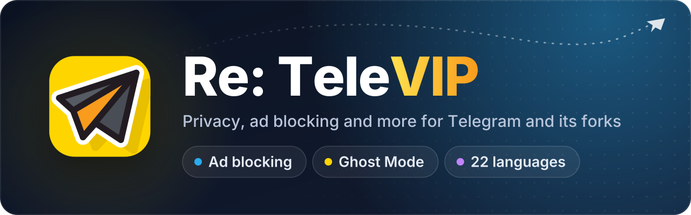
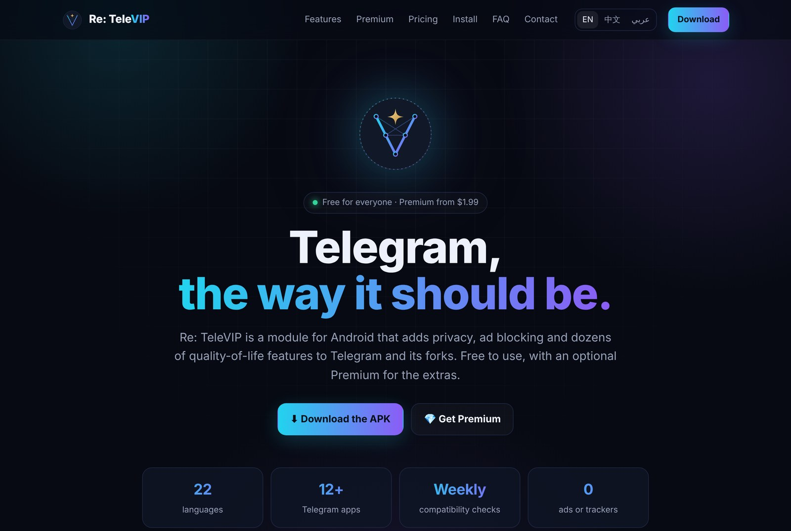

  <a href="README.ar.md">العربية</a> · <a href="README.md">English</a> · <b>简体中文</b>

**为 Telegram 及其分支客户端带来隐私保护、广告屏蔽和各种实用功能， 以 Vector / Xposed 模块的形式运行。**

 

✨&nbsp;<a href="#-功能">功能</a> · 💎&nbsp;<a href="#-高级版">高级版</a> · 🚀&nbsp;<a href="#-快速上手">安装</a> · 📱&nbsp;<a href="#-支持的应用">支持的应用</a> · 🔒&nbsp;<a href="#-它会发送什么">它会发送什么</a> · 📝&nbsp;<a href="CHANGELOG.md">更新日志</a> · 🐞&nbsp;<a href="../../issues">反馈问题</a>

 

功能介绍、高级版和安装指南（中文、English、العربية）请访问 <b><a href="https://re-televip.cc">re-televip.cc</a></b>。

 

## ✨ 功能

<table>
<tr>
  <th width="300">🛡️ 隐私</th>
  <th width="300">🎞️ 媒体与动态</th>
  <th width="300">💬 聊天</th>
</tr>
<tr>
  <td align="center">幽灵模式</td>
  <td align="center">保存受保护的动态</td>
  <td align="center">显示已删除的消息</td>
</tr>
<tr>
  <td align="center">偷偷看动态</td>
  <td align="center">保存阅后即焚媒体 ⭐</td>
  <td align="center">保存编辑历史</td>
</tr>
<tr>
  <td align="center">手机号保护</td>
  <td align="center">保存语音消息</td>
  <td align="center">解锁受限聊天的保存</td>
</tr>
<tr>
  <td align="center">屏蔽广告</td>
  <td align="center">更快下载（测试版）</td>
  <td align="center">隐藏置顶消息</td>
</tr>
<tr>
  <td align="center">显示用户和消息 ID</td>
  <td align="center">液态玻璃外观</td>
  <td align="center">伊斯兰历和波斯历日期</td>
</tr>
<tr>
  <td align="center">显示已读时间</td>
  <td align="center">关闭动态</td>
  <td align="center">消息详情 ⭐</td>
</tr>
</table>

⭐ = 高级版功能，其余全部免费。从 1.7 起，“解锁受限聊天的保存”和本地 Telegram Premium 均免费。所有设置都在客户端自带<b>设置</b>页顶部的 <b>Re: TeleVIP 设置 🛸</b> 中，支持 22 种语言。

 

## 💎 高级版

**可选。** 免费功能永远免费。

| 💎 新增内容 | 💵 价格 |
|---|---|
| 已删除消息的加密云备份 · 实时广告和诈骗名单 · 不限量保留已删除消息（免费版：50 MB）· 隐藏我的号码 · 保存阅后即焚媒体 · 消息详情 · 导出设置，以及更多 | **$1.99**/月 · **$5.49**/3 个月 · **$19.99**/年 · **$19.99** 一年，一次性付款 支持银行卡、PayPal、Apple/Google Pay、微信支付或 USDT（TRC20 或 TON） |

可在 **Re: TeleVIP → 高级版** 或 **[re-televip.cc](https://re-televip.cc/#pricing)** 购买。一份订阅对应一部手机。随时可以取消，14 天内全额退款。 
📄 [条款](https://re-televip.cc/terms) · [隐私](https://re-televip.cc/privacy) · [退款](https://re-televip.cc/refunds)

 

## 🚀 快速上手

<table>
<tr>
  <th width="400">📋 要求</th>
  <th width="400">📥 安装</th>
</tr>
<tr>
  <td valign="top">

- **Vector 2.2 或更高版本** Re: TeleVIP 使用新版 Xposed API（102）。LSPosed 1.9.x 和 EdXposed 只能运行旧模块，而且 LSPosed 无法在 Android 16 上启动。
- 带 Zygisk 的 Root 管理器 Magisk 已内置。使用 KernelSU、KernelSU Next、BakaSU 或 APatch 时，请加装 NeoZygisk 或 Zygisk Next。
- 没有 Root？使用 JingMatrix 的 **[LSPatch 1.2](https://github.com/JingMatrix/LSPatch/releases/latest)** 需要 Android 9 或更高版本，也支持 16 KB 内存页的手机。见下方<i>免 Root</i>。
- Android 8.1 或更高版本
- Android 17 上：Magisk 31.0+ 和 Vector canary 版（3112 或更新） Magisk 30.7 和 Vector 2.2 稳定版在 Android 17 上无法加载模块。

  </td>
  <td valign="top">

1. 从[最新版本](../../releases/latest)下载 `TeleVip-…-release.apk` 并安装。
2. 在 Vector 中：**模块**（Modules）→ 启用 **Re: TeleVIP** → 勾选你的 Telegram 客户端。
3. **强行停止**客户端，然后重新打开。

  </td>
</tr>
</table>

<b>🧰 常见问题</b>

 

- <b>Vector 里看不到从 Google Play 安装的 Telegram，或者加载后没有效果？</b>Google Play 可能以流式（“incremental”）方式安装，而 Vector 不会把模块加载到这种安装中。请使用 <a href="https://telegram.org/android">telegram.org</a> 提供的 Telegram，或者用普通方式重新安装同样的文件：用 <code>adb shell pm path org.telegram.messenger</code> 查到路径，再用 <code>adb pull</code> 复制到电脑，然后用 <code>adb install-multiple -r --no-incremental</code> 安装。聊天记录和登录状态都会保留。之后 Play 的更新可能会让问题再次出现。

- 从 1.0.x 升级？包名在 1.1.0 中已更改：安装新版本，卸载旧的 <i>TeleVip</i>（<code>com.my.televip</code>），然后在 Vector 中启用 <i>Re: TeleVIP</i>。

<b>🔓 免 Root（LSPatch）</b>

 

1. 安装 **Re: TeleVIP** 和 **LSPatch** 管理器。
2. 在 LSPatch 中点 **+**，选择你的 Telegram 客户端并选择修补模式：
   - **本地模式**（Local）：由 LSPatch 提供模块。更新 Re: TeleVIP 后只需重启客户端。
   - **集成模式**（Integrated）：勾选 **嵌入模块**（Embed modules）→ **Re: TeleVIP**。修补后的应用可以独立运行，但每次更新 Re: TeleVIP 都要重新修补。
3. 修补完成后安装生成的应用。如果是本地模式，还要在 LSPatch 的客户端页面里勾选 Re: TeleVIP。

**使用 16 KB 内存页的新手机**（很多 Android 15 及更高版本的手机，以及 Pixel 11 及更新机型）：LSPatch 1.2 放置自身库文件的方式会被这些手机拒绝，所以修补后的客户端一打开就会关闭。打开 **Re: TeleVIP** 应用（它有自己的图标，只在手机上装有 LSPatch 时显示；也可以点 LSPatch 中 Re: TeleVIP 旁边的 **Settings**），点你的客户端旁边的 **为这台手机修复**，Android 询问时点 **更新**。客户端会原地更新：聊天、设置和登录状态都会保留。这个按钮只在需要修复时出现，而且只适用于用 LSPatch 默认密钥修补的客户端；用你自己的密钥库修补的客户端，需要等 LSPatch 加入修复后重新修补（[LSPatch #141](https://github.com/JingMatrix/LSPatch/pull/141)）。

修补后的客户端由 LSPatch 签名，因此 Android 需要先卸载原版客户端。这会删除客户端保存在手机上的内容，包括 Re: TeleVIP 的设置和私密聊天：你需要重新登录，云端聊天会恢复。来自 Play 商店或客户端自带更新程序的更新无法覆盖安装；请改为修补每个新版本。

 

## 📱 支持的应用

与应用内的列表相同，实时更新：每个徽章显示通过我们检查的最新版本。 
每个应用每周检查两次新版本，每次 Re: TeleVIP 发布后也会检查。

<table>
<tr>
  <td align="center" valign="top" width="150"> <b>Telegram</b> </td>
  <td align="center" valign="top" width="150"> <b>Nekogram</b> </td>
  <td align="center" valign="top" width="150"> <b>Cherrygram</b> </td>
  <td align="center" valign="top" width="150"> <b>Nagram</b> </td>
</tr>
<tr>
  <td align="center" valign="top" width="150"> <b>Nagram X</b> </td>
  <td align="center" valign="top" width="150"> <b>Forkgram</b> </td>
  <td align="center" valign="top" width="150"> <b>Forkgram Classic</b> </td>
  <td align="center" valign="top" width="150"> <b>Mercurygram</b> </td>
</tr>
<tr>
  <td align="center" valign="top" width="150"> <b>Momogram</b> </td>
  <td align="center" valign="top" width="150"> <b>Plus Messenger</b> </td>
  <td align="center" valign="top" width="150"> <b>Graph Messenger</b> </td>
  <td align="center" valign="top" width="150"> <b>EntinyGram</b> </td>
</tr>
</table>

完整列表见 [COMPATIBILITY.md](COMPATIBILITY.md)，每个版本的发布说明末尾也附有该列表。应用图标归各自项目所有，仅用于识别。

 

## 🔒 它会发送什么

只发送以下内容，绝不会发送你的 Telegram 账号、手机号、联系人或消息：

- **检查更新和支持的应用列表**，来自 GitHub 或 jsDelivr：每天检查一次更新，每周获取一次支持的应用列表（[compat.json](https://github.com/Dream1Works/Re-TeleVIP/blob/main/compat.json)）。你可以在 **更新** 中关闭检查更新。
- **高级版**，仅在你订阅时发送：你的激活凭证、一个随机手机 ID，以及发出请求的版本号。详见[隐私政策](https://re-televip.cc/privacy)。
- **活跃用户统计**，每天一次：一个随机 ID、模块版本，以及应用、模块和 Hook 的统计数据。不保存 IP 地址。

 

## 💛 赞助支持

利用挤出来的时间写成 ☕ 你的支持让它继续下去： 

## 🙏 致谢

Re: TeleVIP 于 2026 年 9 月作为 **[Mustafa (@mustafa1dev)](https://github.com/mustafa1dev)** 的 [TeleVip-LSPosed](https://github.com/mustafa1dev/TeleVip-LSPosed) 的分支诞生。谢谢你，Mustafa。 
**从 1.5.4 起代码是全新的：** 已经完全重写，不再包含 TeleVip-LSPosed 的代码。 
灵感来自 [Re-Telegram](https://github.com/Sakion-Team/Re-Telegram)、[Gramsieve](https://github.com/Xposed-Modules-Repo/com.tianqianguai.gramsieve)、[Telegami](https://github.com/aoya111/Telegami)、[TeleSpeed](https://github.com/Xposed-Modules-Repo/io.github.tehcneko.telespeed) 和 [TG-Liquid-Glass](https://github.com/YuanhaoBei/TG-Liquid-Glass)。设置页的玻璃透镜改编自 Kyant 的 [AndroidLiquidGlass](https://github.com/Kyant0/AndroidLiquidGlass)（Apache 2.0）。

## 📄 许可

© 2026 Faisal AlDossary。保留所有权利：见 [LICENSE](LICENSE) 和 [NOTICE](NOTICE.md)。复制、修改或重新上传本应用需要获得许可。 
1.5.3 及更早的版本包含 TeleVip-LSPosed 的代码，仍适用 GPL-3.0。 
**Re: TeleVIP** 名称及其标志归 Faisal AlDossary 所有。 
修改版客户端可能给 Telegram 账号带来风险：使用风险自负。

 

---

🌐&nbsp;<a href="https://re-televip.cc">re-televip.cc</a> · 📣&nbsp;<a href="https://t.me/Revived_TeleVIP">@Revived_TeleVIP</a> · 🏢&nbsp;<a href="https://github.com/Dream1Works">Dream1Works</a> · ❤️&nbsp;<a href="https://www.patreon.com/c/Dossary">Patreon</a> · ☕&nbsp;<a href="https://ko-fi.com/2b4g10">Ko-fi</a>

沙特制造 🇸🇦 作者：<a href="https://github.com/2B-4G10">i_2B_4G10</a>🚀

